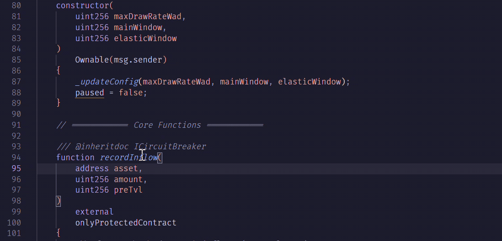
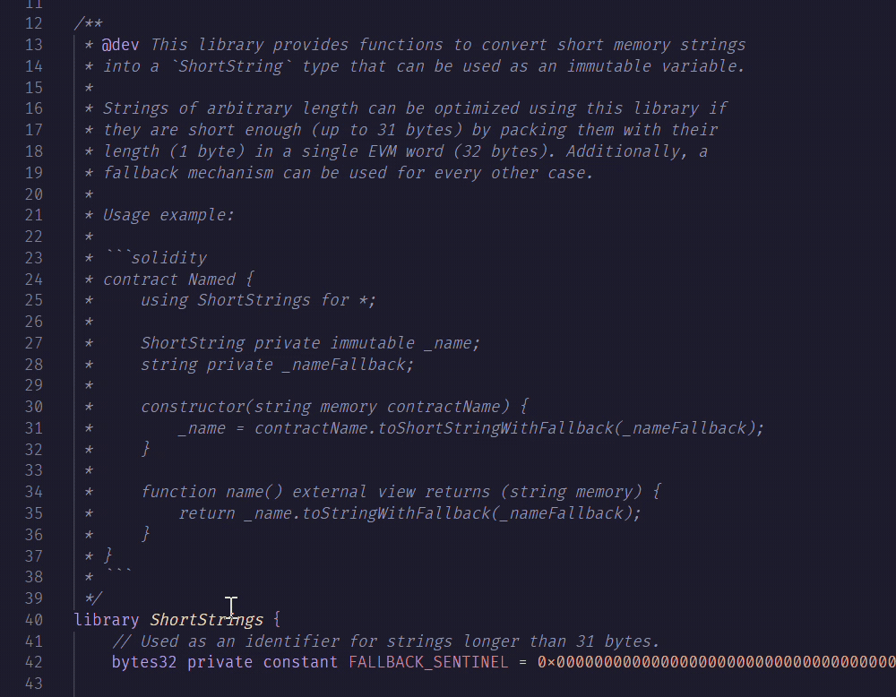
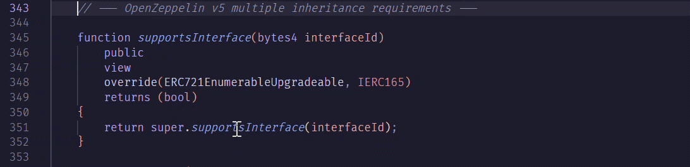
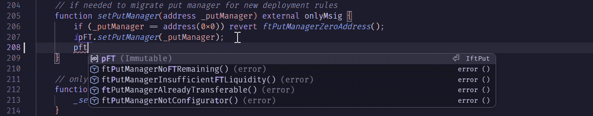
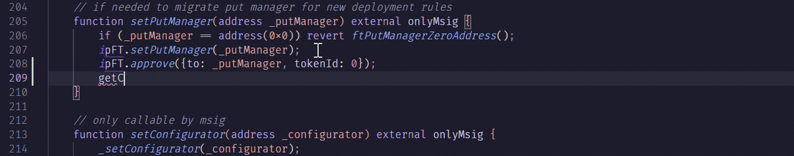
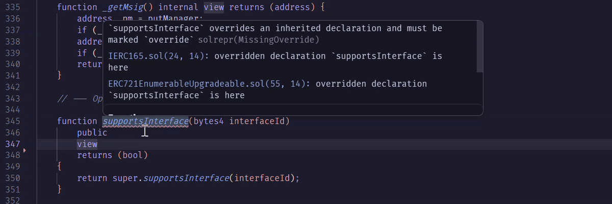

# SolRepr

A semantic analyzer and language server for Solidity.

SolRepr does its own parsing(tree-sitter), name resolution, semantic analysis and type inference in-process, on an incremental engine. 
Compared with a language server that wraps the compiler, there is nothing to run, no compiler round-trip per keystroke, no project rebuild per change. 
Hover, completion and diagnostics stay fast and light on files that have not yet been compiled, no `solc` presence/configuration needed.

`solc` is planned as a completeness layer for what the analyzer deliberately leaves to the
compiler — invoked on demand, never per edit.

## Features

### Hover

Resolved types and signatures, with NatSpec and inline `///` docs rendered as markdown.

`@inheritdoc` is expanded against the matching base member, so an override shows the documentation its base wrote, not the tag.

Documentation is rendered: NatSpec tags and fenced Solidity blocks reformatted and intact.

### Go to definition

Declarations, inherited members, and imports across packages.

### Completions

Scope-, type- and member-aware: locals, inherited members, builtins, `using ... for` functions
and call options. Answered from the inference tables with low latency.

Builtins and inherited members come from the same tables — `push` and `pop` on an array:

### Diagnostics

Semantic errors in real time as you type: unresolved names, failed conversions, mutability and
payability violations etc.

An error names the related locations it was decided from — here the two base declarations that
must appear in the override list — and clears as soon as the list matches.

### Inspection

The lowered HIR and the parsed AST for the current selection, from the command palette.

## Framework support

SolRepr discovers the project from the files already there and resolves imports the way the
framework does — no configuration.

| Layout | Support |
| --- | --- |
| Foundry (`foundry.toml`, `lib/`, remappings) | yes |
| Hardhat (`hardhat.config.*`, `node_modules`) | yes |
| Hybrid Foundry + Hardhat | yes |
| npm / `remappings.txt` | yes |
| Multi-root workspaces | yes |
| Standalone `.sol` files | yes |

## Not yet

Planned:

- Signature help
- Find references
- Rename
- Document and workspace symbols
- Semantic tokens
- Syntax highlighting
- `solc` as a completeness layer — on demand, never per edit

## Requirements

- VS Code 1.91 or newer.
- Analysis only (for now) — Pair with [Solidity Language & Themes](https://marketplace.visualstudio.com/items?itemName=tintinweb.vscode-solidity-language) (`tintinweb.vscode-solidity-language`), for syntax-highlighting and themes.

## Settings

| Setting | Default | Description |
| --- | --- | --- |
| `solrepr.serverPath` | `""` | Path to the server binary. Overrides the bundled copy. |
| `solrepr.trace.server` | `"verbose"` | LSP trace level: `off`, `messages`, `verbose`. |

## Commands

- **SolRepr: View HIR (Lowered)** — show the lowered HIR for the selection.
- **SolRepr: View AST (Named Tree)** — show the tree-sitter AST for the selection.

## Source

https://github.com/Honour-d-dev/SolRepr
